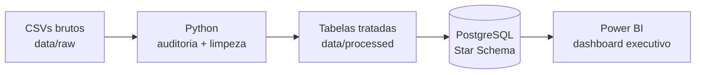
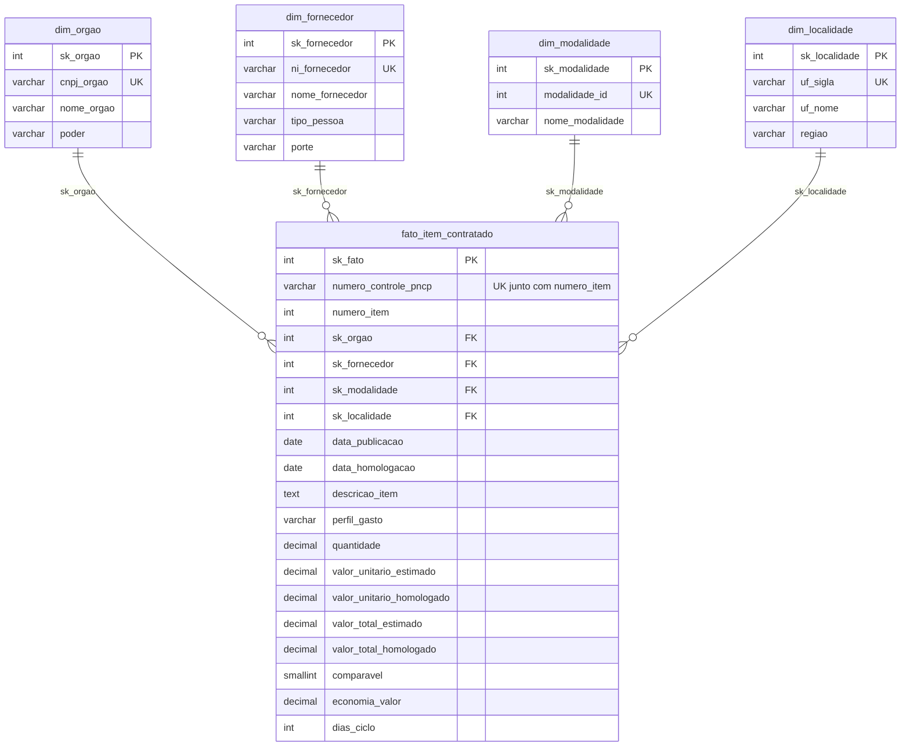
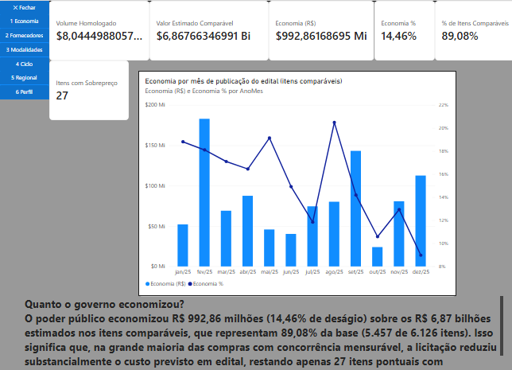
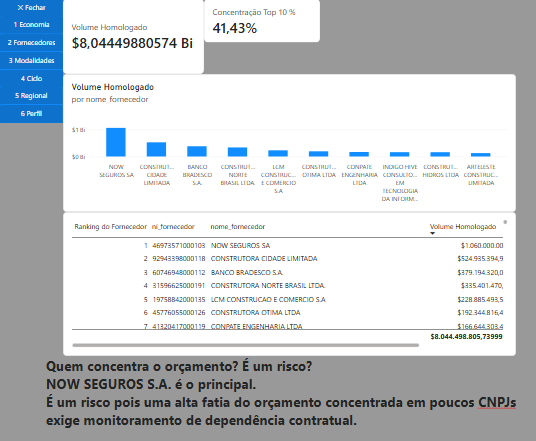
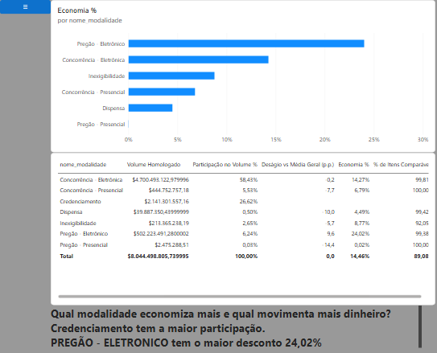

# Controladoria PNCP — Auditoria de Compras Públicas Federais (2025)

> Pipeline ponta a ponta: **PNCP (CSV bruto) → Python (auditoria + limpeza) → PostgreSQL (Star Schema) → Power BI (dashboard executivo)**.

▶️ **Vídeo de apresentação (Review de Sprint):** [PREENCHER: cole aqui o link do Google Drive]

## 1. Contexto do problema

A Controladoria de Compras Públicas precisa monitorar bilhões de reais em licitações federais para identificar riscos operacionais e financeiros críticos: sobrepreço em relação ao valor estimado, alta concentração de orçamento em poucos fornecedores, morosidade excessiva entre a publicação do edital e a homologação, e baixa competitividade em determinadas modalidades. Contudo, os dados brutos extraídos do Portal Nacional de Contratações Públicas (PNCP) chegam com severas inconsistências — documentos sem padronização ou sem zeros à esquerda, valores monetários em múltiplos formatos de texto, datas corrompidas ou cronologicamente impossíveis, *encoding* quebrado (`mojibake`) e múltiplos resultados por item em atas de registro de preços (SRP). Este projeto entrega um pipeline automatizado de engenharia e análise de dados que audita, higieniza e aplica regras de negócio em Python, persiste os dados em um *Star Schema* íntegro no PostgreSQL e disponibiliza um dashboard executivo no Power BI para tomada de decisão.

**Fonte:** Portal Nacional de Contratações Públicas (PNCP), órgãos federais, contratações publicadas em 2025 (02/01/2025 a 31/12/2025), amostra fornecida pelo professor em `data/raw/`.

## 2. Arquitetura



### Estrutura de pastas

```
pncp-controladoria/
├── data/
│   ├── raw/               # CSVs brutos fornecidos (compras, itens, resultados)
│   └── processed/         # tabelas tratadas geradas pelo Python (não versionadas)
├── docs/
│   ├── img/               # figura das Sprints, prints do dashboard
│   └── medidas_dax.md     # calendário e medidas DAX documentados
├── powerbi/               # arquivo .pbix
├── reports/               # relatório de auditoria dos dados brutos
├── sql/
│   ├── 01_criar_banco.sql # DDL do Star Schema
│   ├── 02_perguntas.sql   # consultas das 6 perguntas de negócio
│   └── 03_conferencia.sql # prova real e integridade
├── src/
│   ├── config.py          # caminhos e credenciais (lê o .env)
│   ├── banco.py           # conexão e utilitários do PostgreSQL
│   ├── auditoria.py       # conta os problemas dos dados brutos
│   ├── limpeza.py         # funções de limpeza (CNPJ, dinheiro, datas, texto)
│   ├── montar_tabelas.py  # regras de negócio: fato e dimensões
│   └── carregar.py        # carga em lote no PostgreSQL com validações
├── .env.example
├── .gitignore
├── requirements.txt
└── README.md
```

## 3. Como reproduzir do zero

**Pré-requisitos:** Python 3.10+, PostgreSQL 14+ (ligado), Power BI Desktop (Windows) e Git.

```bash
# 1. Clonar e entrar na pasta
git clone https://github.com/[PREENCHER: SEU_USUARIO]/pncp-controladoria.git
cd pncp-controladoria

# 2. Ambiente virtual e dependências
python -m venv .venv
.venv\Scripts\activate          # Windows   (Mac/Linux: source .venv/bin/activate)
pip install -r requirements.txt

# 3. Credenciais do banco: copie o modelo e coloque a SUA senha do PostgreSQL no .env
copy .env.example .env          # Windows   (Mac/Linux: cp .env.example .env)

# 4. Pipeline (sempre a partir da raiz do projeto)
python -m src.auditoria       # opcional: gera reports/auditoria_dados_brutos.md
python -m src.limpeza         # autoteste das funções de limpeza (todos devem mostrar ✔)
python -m src.montar_tabelas  # gera data/processed/ e imprime a conferência com a prova real
python -m src.carregar        # recria o banco pncp_controladoria, carrega e confere
```

Depois: rode `sql/02_perguntas.sql` no pgAdmin (uma consulta por vez) e abra `powerbi/[PREENCHER: nome_do_arquivo].pbix`
(Página Inicial → **Atualizar**; se pedir senha, use a aba *Banco de dados*).

## 4. Decisões técnicas e por quê

| Decisão | Por quê |
|---|---|
| Ler todos os CSVs como texto (`dtype=str`, `keep_default_na=False`) | Evita que o `pandas` converta CNPJs/CPFs em inteiros (perdendo zeros à esquerda) e impede que strings como `"N/A"` ou `"0"` sejam interpretadas de forma inconsistente antes da limpeza explícita. |
| Descartar resultados cancelados **antes** de escolher o 1º colocado | Em compras com vários classificados (SRP), se o 1º colocado original teve o resultado cancelado (`data_cancelamento` preenchida), o verdadeiro vencedor vigente do item passa a ser o próximo classificado válido. |
| Itens não comparáveis ficam na fato, mas fora da economia | Esses itens representam despesa pública real e precisam compor o Volume Homologado total (R$ 8,04 bilhões), mas possuem distorções de estimativa (razão fora de `[0,1; 10]`) ou são de Credenciamento (modalidade 12), o que contaminaria o cálculo de deságio. |
| Economia % = soma ÷ soma (nunca média de percentuais) | A média simples de percentuais dá o mesmo peso para um item de R$ 100 e para uma obra de R$ 100 milhões. A razão `SUM(economia) / SUM(estimado_comparavel)` reflete o impacto financeiro real no orçamento público. |
| Chaves substitutas (`sk_`) nas dimensões + chave natural `UNIQUE` | Reduz o tamanho da tabela fato (que armazena inteiros de 4 bytes em vez de strings longas de CNPJ), acelera os `JOIN`s no banco e no Power BI e garante que não existam duplicatas da chave de negócio na dimensão. |
| Linha "Não informado" (`sk = -1`) em cada dimensão | Funciona como rede de segurança para integridade referencial: caso algum registro venha sem chave dimensional no futuro, ele aponta para `-1` em vez de quebrar a carga por FK nula ou solta, sem se misturar à sequência `1, 2, 3...`. |
| `economia_valor` nos itens não comparáveis (`0.0` vs `NULL`) | O template do `montar_tabelas.py` grava `0.0` nos itens com `comparavel = 0`, enquanto a modelagem original do banco prevê `NULL`. A constraint `ck_fato_economia_so_comparavel` foi ajustada para aceitar ambos (`IS NULL OR = 0`), e tanto o SQL quanto o DAX filtram explicitamente `comparavel = 1`. |
| `CHECK` no banco como segunda barreira | Garante a integridade dos dados diretamente no SGBD (impedindo quantidades $\le 0$, valores negativos, datas de homologação anteriores à publicação e incoerências no ciclo), protegendo o banco mesmo contra inserções manuais fora do Python. |
| Calendário em DAX com limites vindos dos dados | Em vez de fixar datas manualmente no código, o uso de `MIN` e `MAX` sobre `data_publicacao` e `data_homologacao` torna a tabela `Calendario` dinâmica caso novos exercícios sejam carregados na fato, além de eliminar a hierarquia automática do Power BI. |

### Discordâncias ou ambiguidades do enunciado (a regra foi seguida)

- **Diferença entre `NULL` e `0.0` em `economia_valor` para itens não comparáveis:** A seção 4.3 do enunciado e a DDL original (`01_criar_banco.sql`) especificam `economia_valor` vazia (`NULL`) quando `comparavel = 0`, mas o código fornecido no template `src/montar_tabelas.py` aplica `.where(fato["comparavel"] == 1, 0.0)`. Para preservar os scripts Python intactos, a *constraint* `ck_fato_economia_so_comparavel` no banco foi configurada para aceitar `IS NULL OR economia_valor = 0`, mantendo 100% de compatibilidade nos cálculos.
- **Contagem das dimensões no `src/carregar.py` vs linha técnica `sk = -1`:** O script `01_criar_banco.sql` insere a linha de segurança `sk = -1` nas 4 dimensões, enquanto a conferência simples do `src/carregar.py` executa `SELECT COUNT(*)` sem filtro `WHERE sk_... > 0` (diferente do `03_conferencia.sql`, que filtra `sk > 0`), exibindo `+1` linha na saída do terminal (`364`, `2653`, `8` e `28`).

## 5. Dicionário das inconsistências tratadas

| # | Desafio | Arquivo / coluna | Exemplo bruto | Registros afetados | Como foi tratado |
|---|---|---|---|---|---|
| 1 | CNPJ/CPF | `cnpj_orgao`, `ni_fornecedor` | `11.222.333/0001-81` · `1222333000181` | 1.809 com máscara (176 + 1.633) · 430 sem zero à esquerda (77 + 194 PJ + 159 PF) | só dígitos + `zfill` conforme o tipo (PJ 14 / PF 11); PE (21 registros) intocado |
| 2 | Dinheiro e decimais | `quantidade`, `valor_*` | `R$ 1.234,56` · `1,234.56` · `746.815` · `(1.500,00)` | 12.055 com `R$` · 56.360 ponto sozinho · 8.979 ponto e vírgula · 7.664 vírgula sozinha | `converter_numero`: ponto/vírgula sozinho = decimal; símbolo repetido = milhar |
| 3 | Datas | `data_publicacao`, `data_resultado` | `10/03/2025 14:20` · `20250310` · `0001-01-01` | 6.318 fora do ISO nas duas colunas (723 em `data_publicacao` + 5.595 em `data_resultado`) · 65 datas impossíveis (em `data_encerramento_proposta`) | `converter_data` (6 formatos, anos válidos de 2000 a 2030) |
| 3b | Cronologia | `data_resultado` < `data_publicacao` | homologação antes do edital | 234 resultados brutos (230 itens na fato) | data de homologação anulada (`None`); item permanece na fato sem `dias_ciclo` |
| 4 | Nulos disfarçados | `processo`, `porte`, `categoria_item` | `N/A` · `-` · `0` · `SEM INFORMAÇÃO` | 12.047 (77 em `processo` + 4.893 em `porte` + 7.077 em `categoria_item`) | conjunto `NULOS` em `limpar_texto` (o `"0"` só é tratado como nulo em campos de texto) |
| 5 | Encoding | `descricao`, `objeto_compra`, `nome_unidade`, `nome_fornecedor` | `Aquisição` | 159 em `descricao` (116) e `objeto_compra` (43) · 174 no total (+14 em `nome_unidade` + 1 em `nome_fornecedor`) | reversão de mojibake via `encode('latin-1').decode('utf-8')` |
| 5b | Nomes repetidos | `razao_social_orgao`, `nome_fornecedor` | `Ministério da Saúde` · `MINISTERIO  DA SAUDE ` | 440 grafias → 352 nomes (`razao_social_orgao`) · 559 com espaços extras (58 + 501) | conversão para maiúsculas, colapso de espaços múltiplos e padronização de hífen |
| 6 | Vários classificados (SRP) | `resultados.csv` | 1º colocado cancelado | 405 itens com mais de 1 classificado válido (e 62 resultados cancelados) | exclusão prévia de cancelados; ordenação por `ordem_classificacao_srp` e desempate pelo menor `sequencial_resultado` |

### Itens rejeitados (regra 4) — motivos

O pipeline descartou **99 itens** (dos 6.225 itens que possuíam resultado válido, restando **6.126 itens** na tabela fato) por violarem ao menos um dos critérios de sanidade da Regra 4:

| Critério de rejeição verificado na Etapa 5 | Regra aplicada |
|---|---|
| Orçamento sigiloso | `sigiloso == True` (54 itens na base bruta de itens) |
| Quantidade inválida | `~(quantidade > 0)` |
| Valor unitário estimado ou homologado inválido | `~(valor_unitario_estimado > 0)` ou `~(valor_unitario_homologado > 0)` |
| Valor total estimado irrisório | `valor_total_estimado < R$ 1,00` |
| Distorção extrema de homologação | `valor_total_homologado > 1000 * valor_total_estimado` |
| Estouro de escala numérica | `valor_total_estimado > R$ 1 trilhão` ou `valor_total_homologado > R$ 1 trilhão` |
| **Total líquido de itens rejeitados (união dos critérios)** | **99 itens** |

**Palavras escolhidas para "Obras e engenharia"** (regra 8): `obra(s)`, `construção`, `reforma`, `engenharia`, com limite de palavra `\b` (evita falsos positivos como "cobrança" e "dobradiça").

## 6. Modelo dimensional (Star Schema)



O tempo é a tabela **Calendario**, criada em DAX no Power BI (`docs/medidas_dax.md`), relacionada a `data_publicacao` (ativa) e `data_homologacao` (inativa, usada com `USERELATIONSHIP`).

**Integridade:** PK substitutas, FK da fato para as 4 dimensões, `UNIQUE` nas chaves naturais e no grão (`numero_controle_pncp + numero_item`), `CHECK` (quantidade > 0, sem valor negativo, cronologia, economia só em itens comparáveis) e linha "Não informado" (`sk = -1`) em cada dimensão.

## 7. Prova real (conferência com o anexo 8 do enunciado)

| Conferência | Esperado | Obtido |
|---|---|---|
| Itens na fato | 6.126 | **6.126** |
| Itens rejeitados | 99 | **99** |
| Itens sem resultado (regra 3) | 852 | **852** |
| Contratações distintas | 1.962 | **1.962** |
| Fornecedores / Órgãos (CNPJ) | 2.652 / 363 | **2.652 / 363** |
| Volume homologado | R$ 8.044.498.805,74 | **R$ 8.044.498.805,74** |
| Itens comparáveis | 5.457 | **5.457 (89,08%)** |
| Economia nominal / % | R$ 992.861.686,95 / 14,46% | **R$ 992.861.686,95 / 14,46%** |
| Ciclo médio / máximo / itens sem ciclo | 48,1 / 611 / 230 | **48,1 / 611 / 230** |
| Perfil (% do volume) | Obras 60,8 · Serviços 36,6 · Bens 2,6 | **Obras 60,8% · Serviços 36,6% · Bens 2,6%** |

## 8. Respostas às 6 perguntas de negócio

| # | Pergunta | Resposta | SQL | Power BI |
|---|---|---|---|---|
| 1 | Economia global | Economia nominal de **R$ 992.861.686,95** (**14,46%** de deságio) sobre R$ 6,87 bi estimados nos **5.457** itens comparáveis (89,08% dos 6.126 itens). Volume total homologado: **R$ 8.044.498.805,74**. | `02_perguntas.sql` — P1 | Página 1 · Economia (R$) e Economia % |
| 2 | Concentração de fornecedores | Dos **2.652** fornecedores distintos, os 10 maiores concentram **[PREENCHER: pct_top10 da consulta P2B]%** (R$ [PREENCHER: volume_top10]) do volume total homologado, liderados por [PREENCHER: 1º colocado da P2A]. | P2A e P2B | Página 2 · Concentração Top 10 % |
| 3 | Eficácia por modalidade | Maior volume financeiro em **[PREENCHER: 1ª modalidade da P3]** ([PREENCHER: %]% do total) e maior deságio percentual em **[PREENCHER: modalidade com maior desagio_pct da P3]** ([PREENCHER: %]%). No Credenciamento o deságio é nulo por não haver disputa. | P3 | Página 3 · Deságio vs Média Geral (p.p.) |
| 4 | Ciclo de compras por órgão | Duração média de **48,1 dias** entre publicação e homologação (máximo de **611 dias**), com **230 itens** sem ciclo (homologação anterior ao edital anulada). O órgão mais lento (com $\ge 5$ itens) é [PREENCHER: 1º órgão da P4B] ([PREENCHER: dias] dias em média). | P4A e P4B | Página 4 · Ciclo Médio (dias) |
| 5 | Distribuição regional | Entre as **363** unidades compradoras, a região **[PREENCHER: 1ª região da P5B]** e a UF **[PREENCHER: 1ª UF da P5A]** concentram o maior volume homologado ([PREENCHER: %]%), enquanto o maior deságio regional ocorre no **[PREENCHER: região/UF com maior desagio_pct]** ([PREENCHER: %]%). | P5A e P5B | Página 5 · Participação no Volume % |
| 6 | Perfil dos gastos | **Obras e engenharia** concentram **60,8%** do orçamento (967 itens), seguidas por **Serviços** com **36,6%** (1.849 itens) e **Bens** com apenas **2,6%** do valor total, apesar de representarem a maioria em quantidade (**3.310 itens**). | P6 | Página 6 · Ticket Médio por Item (R$) |

### Dashboard

<!-- Salve os prints do seu Power BI na pasta docs/img/ com estes nomes ou ajuste os caminhos abaixo: -->




## 9. Técnicas e tecnologias

Python 3 (`pandas`, `psycopg2`), PostgreSQL (DDL, `CHECK`/`UNIQUE`/`FOREIGN KEY` constraints, CTEs, *window functions* com `RANK() OVER`), modelagem dimensional (*Star Schema*, chaves substitutas `sk_`), Power BI (DAX com `VAR`/`RETURN`, `CALCULATE`, funções iteradoras `RANKX` e `SUMX`, `USERELATIONSHIP`, `KEEPFILTERS`, `TOPN`, *bookmarks* com seleção de visuais, *tooltips* de página e princípios de design CRAP), Git/GitHub (fluxo em *branches* por Sprint) e Trello (planejamento Ágil).

## 10. Planejamento em Sprints


Cada Sprint foi desenvolvida em uma branch dedicada (`sprint-0-...` a `sprint-7-...`) e integrada à `main` via *merge* após a validação dos entregáveis. Ao longo da execução, a etapa de carga no banco (Sprint 4) exigiu atenção especial para conciliar o tratamento de itens não comparáveis entre o script Python (`0.0`) e a restrição `CHECK` do PostgreSQL, além da validação das linhas técnicas (`sk = -1`) nas dimensões antes da construção das medidas DAX na Sprint 6.

## 11. Melhorias futuras

- **Orquestração do pipeline em comando único:** Criar um `main.py` na raiz para executar em sequência auditoria, autoteste de limpeza, montagem das tabelas e carga no PostgreSQL com geração de logs estruturados.
- **Testes unitários automatizados com `pytest`:** Transformar os casos de teste do `src/limpeza.py` em uma suíte formal integrada ao GitHub Actions (CI) para validar cada *commit*.
- **Ingestão direta via API do PNCP:** Substituir a leitura estática dos CSVs de `data/raw/` por um módulo extrator que consuma os *endpoints* públicos da API do PNCP de forma incremental.
- **Uso de `Decimal` no processamento em Python:** Substituir ponto flutuante (`float64`) pela biblioteca `decimal.Decimal` durante as transformações em memória para espelhar com exatidão o tipo `DECIMAL(18,2)` do PostgreSQL.
- **Publicação no Power BI Service com Gateway:** Automatizar a atualização agendada do conjunto de dados conectando o Power BI Service diretamente ao banco PostgreSQL.

## 12. Autor

**[PREENCHER: Seu Nome Completo]** · Turma **[PREENCHER: Sua Turma]** · Projeto Avaliativo — Módulo 2, Análise de Dados com Python.