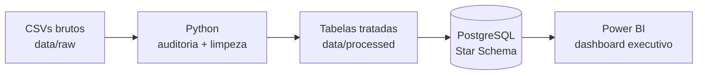
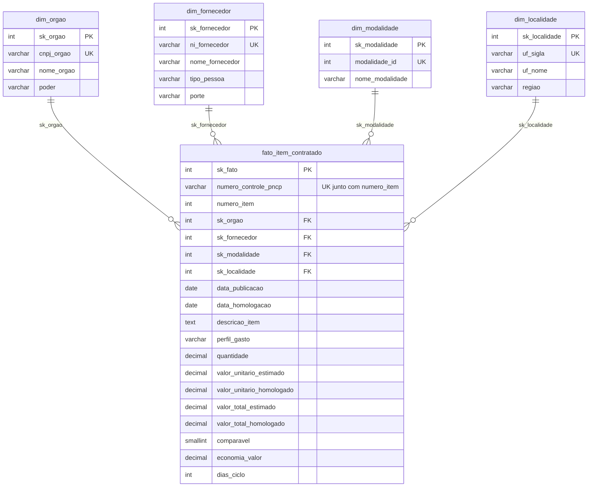
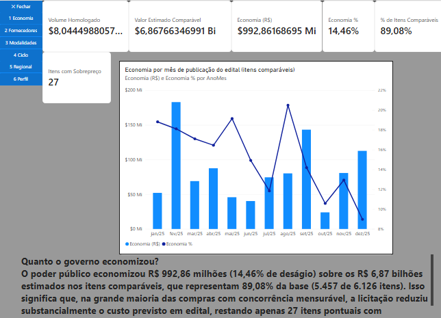
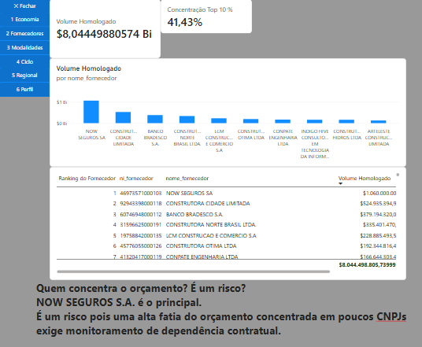
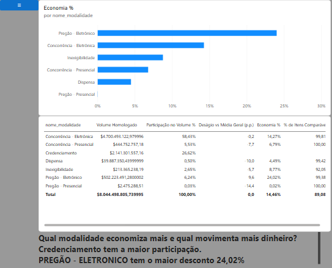

# Controladoria PNCP — Auditoria de Compras Públicas Federais (2025)

> Pipeline ponta a ponta: **PNCP (CSV bruto) → Python (auditoria e limpeza) → PostgreSQL (Star Schema) → Power BI (dashboard executivo)**.

▶️ **Vídeo de apresentação (Review de Sprint):** (https://drive.google.com/file/d/1U7_6kwgsSjjtn0bF1rnVs6br4j__CwUv/view?usp=drivesdk)

## 1. Contexto do problema

A Controladoria identificou gargalos nas compras públicas federais: indícios de **sobrepreço**, **concentração** de contratos em poucos fornecedores, **morosidade** entre a publicação do edital e a homologação, e baixa competição em certas modalidades. Para piorar, os sistemas de origem não validam os dados na entrada, e o repositório bruto chega com CNPJ corrompido, valores monetários em texto livre, datas em vários formatos, nulos disfarçados e erros de acentuação. Por isso, os relatórios feitos direto sobre esses dados não são confiáveis.

Este projeto constrói uma esteira que audita e limpa esses dados, organiza-os num modelo dimensional no PostgreSQL e entrega um dashboard no Power BI que responde a 6 perguntas de negócio da Controladoria: economia global, concentração de fornecedores, eficácia por modalidade, tempo do ciclo de compras, distribuição regional e perfil dos gastos.

**Fonte:** Portal Nacional de Contratações Públicas (PNCP), órgãos federais, contratações publicadas em 2025 (02/01/2025 a 31/12/2025). Os arquivos brutos, uma amostra ao longo do ano (não são todas as contratações do país), foram extraídos pelo professor e estão em `data/raw/`.

## 2. Arquitetura



### Estrutura de pastas

```
pncp-controladoria/
├── data/
│   ├── raw/               # CSVs brutos fornecidos (compras, itens, resultados)
│   └── processed/         # tabelas tratadas geradas pelo Python (não versionadas)
├── docs/
│   ├── img/               # figura das Sprints e prints do dashboard
│   └── medidas_dax.md     # calendário e medidas DAX documentados
├── powerbi/               # arquivo .pbix
├── reports/
│   └── auditoria_dados_brutos.md   # relatório gerado pela auditoria
├── sql/
│   ├── 01_criar_banco.sql # DDL do Star Schema
│   ├── 02_perguntas.sql   # consultas das 6 perguntas de negócio
│   └── 03_conferencia.sql # prova real e integridade
├── src/
│   ├── config.py          # caminhos e credenciais (lê o .env)
│   ├── banco.py           # conexão e utilitários do PostgreSQL
│   ├── auditoria.py       # conta os problemas dos dados brutos
│   ├── limpeza.py         # funções de limpeza (CNPJ, dinheiro, datas, texto)
│   ├── montar_tabelas.py  # regras de negócio: fato e dimensões
│   └── carregar.py        # carga em lote no PostgreSQL
├── .env.example
├── .gitignore
├── requirements.txt
└── README.md
```

## 3. Como reproduzir do zero

**Pré-requisitos:** Python 3.10+, PostgreSQL 14+ (ligado), Power BI Desktop (Windows) e Git.

```bash
# 1. Clonar e entrar na pasta
git clone https://github.com/kauan-rda/pncp-controladoria.git
cd pncp-controladoria

# 2. Ambiente virtual e dependências
python -m venv .venv
.venv\Scripts\activate          # Windows   (Mac/Linux: source .venv/bin/activate)
pip install -r requirements.txt

# 3. Credenciais do banco: copie o modelo e coloque a SUA senha do PostgreSQL no .env
copy .env.example .env          # Windows   (Mac/Linux: cp .env.example .env)

# 4. Pipeline (sempre a partir da raiz do projeto)
python -m src.auditoria       # opcional: gera reports/auditoria_dados_brutos.md
python -m src.limpeza         # autoteste das funções de limpeza (54 de 54 devem mostrar ✔)
python -m src.montar_tabelas  # gera data/processed/ e imprime a conferência com a prova real
python -m src.carregar        # recria o banco pncp_controladoria, carrega e confere
```

Depois:

1. No pgAdmin, rode `sql/03_conferencia.sql` e `sql/02_perguntas.sql` (uma consulta por vez: selecione o texto e aperte F5).
2. Abra `powerbi/pncp_controladoria.pbix` no Power BI Desktop e clique em **Atualizar** (se pedir senha, use a aba *Banco de dados* e a senha do seu PostgreSQL).

## 4. Decisões técnicas e por quê

| Decisão | Por quê |
|---|---|
| Ler todos os CSVs como texto (`dtype=str`) | Evita que o pandas converta o CNPJ em número (e perca os zeros à esquerda) ou transforme "N/A" e "0" em vazio antes de eu decidir o que é nulo. |
| Descartar os resultados cancelados **antes** de escolher o 1º colocado | Se o 1º colocado foi cancelado, o 2º assume. Escolher o 1º primeiro faria o item sumir (6.065 itens na fato em vez de 6.126). |
| Itens não comparáveis ficam na fato, mas fora da economia | No Credenciamento o valor estimado é um teto global, e razões homologado/estimado fora de 0,1 a 10 indicam erro. Esses itens entram no volume, mas distorceriam a economia (perto de 75% em vez de 14,46%). |
| Economia % = soma ÷ soma (nunca média de percentuais) | A média de percentuais daria o mesmo peso a um item de R$ 10 mil e a um de R$ 100 milhões. |
| Chaves substitutas (`sk_`) nas dimensões e chave natural `UNIQUE` | A chave substituta é pequena e estável para as FKs; a `UNIQUE` na chave natural (CNPJ, UF, id da modalidade) impede duplicatas. |
| Linha "Não informado" (`sk = -1`) em cada dimensão | Rede de segurança: se faltar a dimensão, a FK aponta para -1 em vez de ficar solta. Fica fora da sequência 1, 2, 3… e não conta nas linhas esperadas. |
| `economia_valor` = 0 nos itens não comparáveis | Segue o kit do professor. A restrição `ck_fato_economia_so_comparavel` foi ajustada para aceitar vazio ou 0 nesses itens. As somas da economia são idênticas nas duas formas. |
| `CHECK` e `DECIMAL` no banco | Segunda barreira, depois do Python: o banco recusa quantidade ≤ 0, valor negativo, homologação anterior à publicação e ciclo incoerente. Dinheiro em `DECIMAL`, nunca em `FLOAT`. |
| Carga em lote (`execute_values`) com as dimensões antes da fato | Um comando por tabela em vez de um por linha. As dimensões vêm primeiro porque a fato tem chave estrangeira para elas. |
| Calendário em DAX com limites vindos dos dados | O intervalo vai da menor data de publicação à maior de homologação; o mês é ordenado pelo número; há duas relações com a fato (publicação ativa, homologação inativa, usada com `USERELATIONSHIP`). |

### Discordâncias e ambiguidades do enunciado (a regra foi seguida)

- **`economia_valor` nos itens não comparáveis:** a seção 4.3 diz que fica "vazia", mas o kit grava 0.0. Segui o kit e ajustei a restrição do banco. A soma da economia não muda.
- **Linha "Não informado" do fornecedor:** nesta base nenhum vencedor ficou sem documento, então a linha `-1` existe como segurança, mas nenhum item aponta para ela.

## 5. Dicionário das inconsistências tratadas

Os números vêm do relatório [`reports/auditoria_dados_brutos.md`](reports/auditoria_dados_brutos.md), gerado por `python -m src.auditoria`.

| # | Desafio | Arquivo / coluna | Exemplo bruto | Registros afetados | Como foi tratado |
|---|---|---|---|---|---|
| 1 | CNPJ/CPF | `compras.csv` · `cnpj_orgao` | `11.222.333/0001-81` · `1222333000181` | 176 com máscara; 77 sem o zero à esquerda; 539 CNPJ distintos como vieram → 370 unidades reais | `limpar_documento`: só dígitos e `zfill(14)` (PJ) |
| 1 | CNPJ/CPF | `resultados.csv` · `ni_fornecedor` | `111.444.777-35` · `1234567890` | 1.633 com máscara; 194 PJ e 159 PF sem o zero; 21 estrangeiros (PE) | `zfill` conforme o tipo (PJ 14, PF 11); PE só em maiúsculas |
| 2 | Dinheiro e decimais | `itens.csv` · `quantidade`, `valor_unitario_estimado` | `R$ 1.234,56` · `1,234.56` · `12,5` · `746.815` | com R$: 1.148 e 1.188; ponto e vírgula: 219 e 649; vírgula sozinha: 1.262 e 953; ponto sozinho: 5.596 e 5.475 | `converter_numero`: ponto ou vírgula sozinho é decimal; símbolo repetido é milhar; quando há os dois, o último é o decimal |
| 2 | Dinheiro e decimais | `resultados.csv` · `quantidade_homologada`, `valor_unitario_homologado` | `R$ 2.000,00` · `493231.6000` | com R$: 2.561 e 2.650; ponto e vírgula: 1.179 e 1.537; vírgula sozinha: 2.245 e 2.077; ponto sozinho: 12.472 e 12.282 | idem. Valores negativos entre parênteses: nenhum nesta base (a função trata mesmo assim) |
| 3 | Datas em vários formatos | `compras.csv` · `data_publicacao` | `2025-03-10T08:30:00` · `10/03/2025 14:20` · `10.03.2025` · `20250310` | 7 formatos: 1.319 ISO com hora; 138 `DD-MM-AAAA`; 126 `DD/MM/AAAA HH:MM`; 120 `DD.MM.AAAA`; 117 `DD/MM/AAAA`; 116 `AAAA/MM/DD`; 106 `AAAAMMDD` | `converter_data`: 6 formatos, descarta a hora, aceita só anos de 2000 a 2030 (derruba `0001-01-01` e `31/02/2025`) |
| 3 | Datas em vários formatos | `resultados.csv` · `data_resultado` | idem | 7 formatos: 10.301 `AAAA-MM-DD`; entre 912 e 960 em cada um dos outros 6 | idem |
| 3 | Datas impossíveis | `compras.csv` · `data_encerramento_proposta` | data fora de 2000–2030 ou inexistente | 65 (coluna não usada na fato) | `converter_data` devolve vazio |
| 3b | Cronologia | `data_resultado` anterior a `data_publicacao` | homologação antes do edital | 234 resultados; 230 itens da fato ficam sem ciclo | a data de homologação é anulada; o item continua na fato, sem `dias_ciclo` |
| 4 | Nulos disfarçados | `processo`; `porte`; `categoria_item`; `unidade_medida` | `N/A` · `-` · `0` · `SEM INFORMAÇÃO` · `Não se aplica` | `processo`: 77; `porte`: 4.893; `categoria_item`: 7.077 (todas); `unidade_medida`: 9 vazias | conjunto `NULOS`; o `0` só é nulo em campo de texto (em quantidade e valor é número) |
| 5 | Acento quebrado (Latin-1 lido como UTF-8) | `descricao`; `objeto_compra`; `nome_unidade`; `nome_fornecedor` | `Aquisição` | 116; 43; 14; 1 | `texto.encode('latin-1').decode('utf-8')` |
| 5 | Caracteres invisíveis | `compras.csv` · `objeto_compra` | espaço de largura zero | 1 | `remover_invisiveis` |
| 5b | Espaços sobrando e "sem quebra" | `itens.csv` (`descricao`, `unidade_medida`); `compras.csv` (`objeto_compra`, `nome_unidade`, `razao_social_orgao`); `resultados.csv` (`nome_fornecedor`) | `MINISTERIO  DA SAUDE ` | 606 e 935; 519, 63 e 58; 501 | `tirar_espacos` (`split` e `join`) |
| 5b | Nomes repetidos | `razao_social_orgao` | `Ministério da Saúde` · `MINISTERIO  DA SAUDE ` | 440 grafias → 352 nomes | `padronizar_nome`: maiúsculas, espaços e hífen padronizados |
| 6 | Vários classificados (SRP) | `resultados.csv` | 1º colocado cancelado | 62 cancelados; 405 itens com mais de um classificado; 11.976 resultados sem ordem (vale 1) | cancelados saem primeiro; fica o de menor ordem e, no empate, o de menor `sequencial_resultado` (lido como número) |
| 7 | Itens sem resultado | `itens.csv` | item sem fornecedor vencedor | 852 | ficam fora da fato (regra 3); não contam como rejeitados |
| 8 | Orçamento sigiloso | `itens.csv` · `sigiloso` | `True` | 54 itens no arquivo | rejeitados quando entram na avaliação (regra 4) |

### Itens rejeitados (regra 4): 99 no total

Só são avaliados os 6.225 itens que têm resultado. Se o item cai em vários casos, conta-se o primeiro motivo da lista.

| Motivo | Itens |
|---|---|
| Valor total estimado menor que R$ 1 | 59 |
| Valor unitário estimado ausente ou menor ou igual a zero | 23 |
| Valor total homologado mais de 1.000 vezes o estimado | 7 |
| Valor unitário homologado ausente ou menor ou igual a zero | 6 |
| Algum valor total acima de R$ 1 trilhão (estoura o `DECIMAL` do banco) | 3 |
| Quantidade vazia ou menor ou igual a zero | 1 |

**Palavras escolhidas para "Obras e engenharia"** (regra 8): `obra(s)`, `construção`, `reforma` e `engenharia`, buscadas na descrição do item e no objeto da contratação, com limite de palavra `\b` (assim "cobrança" e "dobradiça" não viram obra). Obras tem prioridade sobre Bens e Serviços.

## 6. Modelo dimensional (Star Schema)



A **fato** guarda o que se mede (valores, quantidades, datas) e a descrição do item, com uma linha por item de contratação e o vencedor do item. Cada **dimensão** guarda quem (órgão, fornecedor), como (modalidade) e onde (UF e região). O tempo é a tabela **Calendario**, criada em DAX no Power BI (ver [`docs/medidas_dax.md`](docs/medidas_dax.md)).

**Integridade garantida pelo banco:**

- chaves primárias substitutas e chaves estrangeiras da fato para as 4 dimensões;
- `UNIQUE` nas chaves naturais e no grão (`numero_controle_pncp` + `numero_item`);
- `CHECK`: quantidade maior que 0, sem valor negativo, homologação não anterior à publicação, `economia_valor` só em itens comparáveis (ou 0), ciclo coerente com a data;
- linha "Não informado" (`sk = -1`) em cada dimensão;
- `DECIMAL(18,2)` para dinheiro e `DECIMAL(18,4)` para preço unitário e quantidade.

## 7. Prova real (conferência com o anexo 8 do enunciado)

| Conferência | Esperado | Obtido |
|---|---|---|
| Itens na fato | 6.126 | 6.126 |
| Itens rejeitados | 99 | 99 |
| Itens sem resultado (regra 3) | 852 | 852 |
| Contratações distintas | 1.962 | 1.962 |
| Fornecedores / Órgãos (CNPJ) | 2.652 / 363 | 2.652 / 363 |
| Volume homologado | R$ 8.044.498.805,74 | R$ 8.044.498.805,74 |
| Itens comparáveis | 5.457 | 5.457 |
| Economia nominal / % | R$ 992.861.686,95 / 14,46% | R$ 992.861.686,95 / 14,46% |
| Ciclo médio / máximo / itens sem ciclo | 48,1 / 611 / 230 | 48,1 / 611 / 230 |
| Perfil (% do volume) | Obras 60,8 · Serviços 36,6 · Bens 2,6 | Obras 60,8 · Serviços 36,6 · Bens 2,6 |

No banco, `sql/03_conferencia.sql` confirma as mesmas contagens (a linha técnica `sk = -1` não conta), **0 chaves estrangeiras soltas** e nenhum item repetido no grão.

## 8. Respostas às 6 perguntas de negócio

Os números abaixo saem das consultas de [`sql/02_perguntas.sql`](sql/02_perguntas.sql) e são os mesmos do dashboard.

**1. Economia global.** O governo economizou **R$ 992.861.686,95**, ou **14,46%** do valor estimado dos itens comparáveis (R$ 6,87 bi estimados contra R$ 5,87 bi homologados). Dos 6.126 itens, 5.457 (89,08%) são comparáveis; os demais entram no volume total de R$ 8,04 bi, mas não na economia.
*Fonte: SQL P1 · Power BI, página 1 (Economia R$ e Economia %).*

**2. Concentração de fornecedores.** Os 10 maiores fornecedores concentram **41,43%** do volume (R$ 3,33 bi de R$ 8,04 bi), entre 2.652 fornecedores. O maior é NOW SEGUROS SA, com 13,18% (R$ 1,06 bi), seguido por CONSTRUTORA CIDADE LIMITADA (6,53%) e BANCO BRADESCO S.A. (4,71%).
*Fonte: SQL P2A e P2B · Power BI, página 2 (Concentração Top 10 %).*

**3. Eficácia por modalidade.** A **Concorrência Eletrônica** movimenta o maior volume (58,43%, R$ 4,70 bi) com deságio de 14,27%. O maior deságio é do **Pregão Eletrônico** (24,02%), que tem só 6,24% do volume. O **Credenciamento** responde por 26,62% do volume, mas não tem deságio calculável (o estimado é um teto global, então nenhum item é comparável).
*Fonte: SQL P3 · Power BI, página 3 (Deságio vs Média Geral).*

**4. Tempo do ciclo.** O ciclo médio entre a publicação e a homologação é de **48,1 dias** (máximo de 611); 230 itens ficam sem ciclo por terem homologação anterior à publicação. Entre os 142 órgãos com 5 ou mais itens com ciclo, os mais lentos são a Universidade Federal de Campina Grande (266,3 dias), o Conselho Federal de Engenharia e Agronomia (223,0) e o DNIT (156,2).
*Fonte: SQL P4A e P4B · Power BI, página 4 (Ciclo Médio).*

**5. Distribuição regional.** O **Centro-Oeste** concentra 44,25% do volume, e só o Distrito Federal responde por 38,98%. O melhor desconto por região é o do **Norte** (21,43%). Entre os estados, os maiores deságios são Acre (26,71%), Mato Grosso (25,84%) e Bahia (25,01%).
*Fonte: SQL P5A e P5B · Power BI, página 5 (Participação no Volume %).*

**6. Perfil dos gastos.** **Obras e engenharia** respondem por 60,8% do volume (967 itens; ticket médio de R$ 5,06 mi), **Serviços** por 36,6% (1.849 itens) e **Bens** por 2,6% (3.310 itens; ticket médio de R$ 63,8 mil).
*Fonte: SQL P6 · Power BI, página 6 (Ticket Médio por Item).*

### Dashboard

PREENCHER:





O dashboard tem 6 páginas (uma por pergunta, com a conclusão na tela), menu retrátil com botões e indicadores (bookmarks), tooltips de página, Calendário em DAX e 15 medidas explícitas organizadas em pastas de exibição por pergunta, documentadas em [`docs/medidas_dax.md`](docs/medidas_dax.md).

## 9. Técnicas e tecnologias

Python 3 (pandas, psycopg2), PostgreSQL (DDL, constraints, CTE, funções de janela), modelagem dimensional (Star Schema, chaves substitutas), Power BI (DAX com `VAR`/`RETURN`, `CALCULATE`, iteradoras, `USERELATIONSHIP`, bookmarks, tooltip de página), Git e GitHub (uma branch por Sprint, commits pequenos no imperativo) e Trello (planejamento).

## 10. Planejamento em Sprints


| Sprint | Branch | Objetivo | Entrega |
|---|---|---|---|
| 0 | `sprint-0-planejamento` | repositório, ambiente e entendimento dos dados | pastas, `.gitignore`, `.env.example`, `requirements.txt`, CSVs em `data/raw` |
| 1 | `sprint-1-auditoria` | contar os problemas dos dados brutos | `src/auditoria.py` e `reports/auditoria_dados_brutos.md` |
| 2 | `sprint-2-limpeza` | funções de limpeza provadas por teste | `src/limpeza.py` (54 de 54 exemplos) |
| 3 | `sprint-3-tabelas` | regras de negócio, fato e dimensões | `src/montar_tabelas.py` batendo com a prova real |
| 4 | `sprint-4-banco` | Star Schema com integridade e carga automática | `sql/01_criar_banco.sql`, `src/carregar.py`, `sql/03_conferencia.sql` |
| 5 | `sprint-5-perguntas-sql` | responder as 6 perguntas em SQL | `sql/02_perguntas.sql` |
| 6 | `sprint-6-powerbi` | dashboard com as 6 perguntas | `powerbi/pncp_controladoria.pbix` |
| 7 | `sprint-7-documentacao` | README, figura das Sprints e vídeo | este README, `docs/img/sprints.png` e o vídeo |

Cada Sprint foi uma branch, integrada à `main` por merge. As branches foram mantidas para preservar o histórico.

**O que mudou ao longo do caminho:**

- Na **Sprint 0**, o primeiro commit saiu grande: preparei o ambiente antes de abrir o repositório e enviei as pastas juntas. A partir da Sprint 1, passei a commitar por etapa.
- Na **Sprint 3**, fiz o merge pelo navegador (GitHub) e a `main` local divergiu da remota; integrei as duas com `git pull` e segui.
- Na **Sprint 4**, a carga na fato falhou na restrição de `economia_valor`: o kit grava 0 nos itens não comparáveis e o meu DDL exigia vazio. Ajustei a restrição para aceitar vazio ou 0 e repeti a carga.

## 11. Melhorias futuras

- Automatizar o pipeline com um único comando (`main.py` ou Makefile) e agendar a atualização.
- Criar testes automatizados (pytest) para as funções de `limpeza.py`, partindo dos 54 exemplos do autoteste.
- Consumir a API oficial do PNCP para atualizar a base sem CSV manual.
- Trocar `float` por `Decimal` no tratamento de valores monetários, para eliminar diferenças de centavos.
- Publicar o dashboard no Power BI Service com atualização agendada.
- Separar serviços continuados de eventuais (opcional do enunciado) e detalhar o perfil do gasto.
- Criar views no PostgreSQL com as 6 perguntas para o Power BI consumir direto.

## 12. Autor

Kauan Raitz dos Anjos · Projeto Avaliativo do Módulo 2, Análise de Dados com Python.